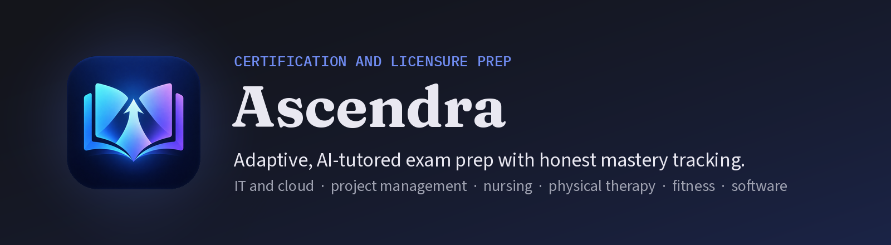
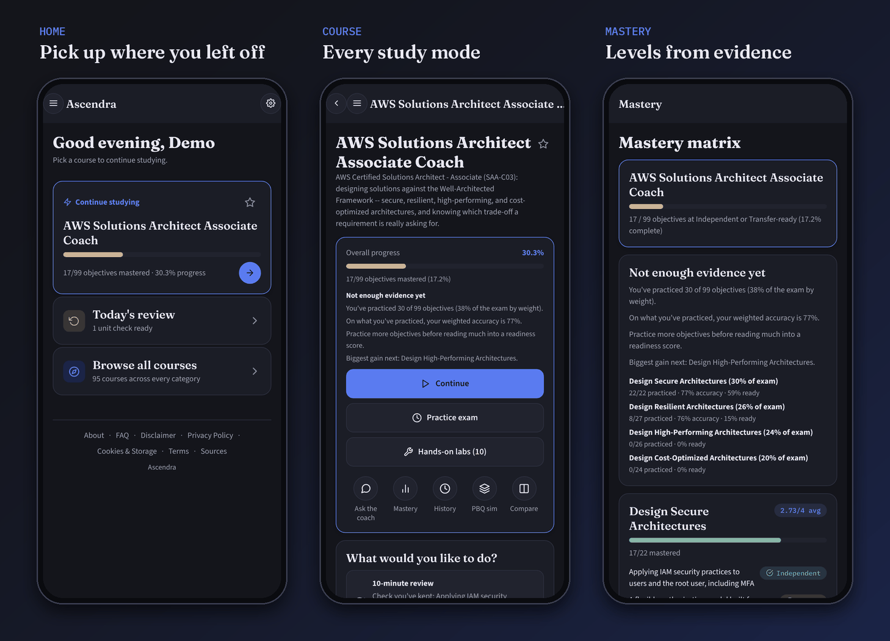
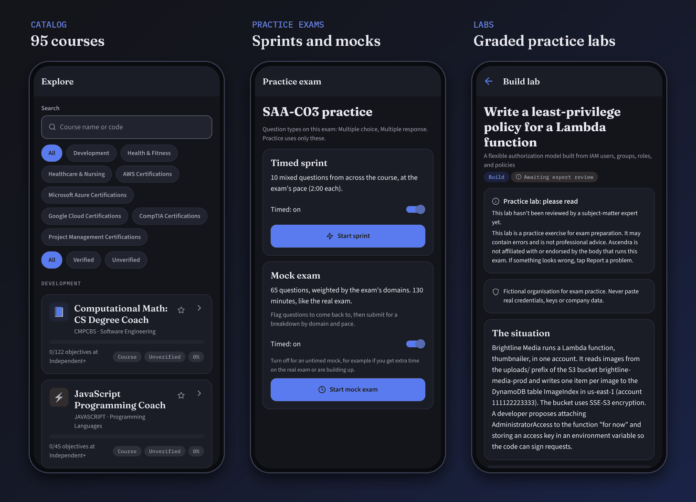

  

  
  

**Ascendra is a study coach for certification and licensure exams.** Pick the exam you're working toward and Ascendra teaches it in short lessons, has you practice until you can do it on your own, brings it back before you forget it, and tests you the way the real exam will.

It also tells you the truth about where you stand. Progress comes from what you've shown you can do, not from time spent in the app, and when there isn't enough evidence yet to call you ready, it says so.

Ascendra runs on iPhone, Android and the web.

## Contents

- [Who it's for](#who-its-for)
- [How learning works](#how-learning-works)
- [Progress you can trust](#progress-you-can-trust)
- [Screenshots](#screenshots)
- [Safety and trust](#safety-and-trust)
- [Content, sources and legal](#content-sources-and-legal)
- [For developers](#for-developers)
- [License](#license)

## Who it's for

Learners preparing for a specific exam who want to know whether they're actually ready. The catalog has **116 courses**:

- **IT and cloud (65):** 18 CompTIA, 15 Kubernetes and CNCF, 11 AWS, 11 Google Cloud and 10 Microsoft Azure certifications
- **Physical therapy (14):** NPTE-PT, NPTE-PTA, the DPT pathway, the ABPTS specialist certifications and a PT school prerequisites refresher
- **Project management (12):** PMI certifications
- **Nursing and critical care (10):** CNA through BSN, NCLEX-RN and NCLEX-PN, CCRN (adult, pediatric, neonatal) and MS Health Informatics
- **Fitness (6):** NASM, ACE, ACSM, NSCA (CPT and CSCS) and NCCPT personal trainer certifications
- **Emergency medical services (4):** NREMT Emergency Medical Responder, EMT, Advanced EMT and Paramedic
- **Software development (4):** Python, JavaScript, Computer Science Degree Foundations and MSCS foundations
- **Mental health (1):** the EPPP (psychology licensure), behind a one-time 18+ confirmation

Exam-prep courses are named "Prep for the <official exam name> Exam"; Ascendra is not the exam body. Certification courses carry the exam's own domain weights, so you spend your time where the exam does.

## How learning works

Every course runs the same loop. You learn a topic, practice it with help, prove it without help, and then it comes back on a schedule until it sticks.

**Getting started.** Tell the app your goal, your exams and their dates, your experience and how much time you have each week. Your plan works back from the exam date, and an optional placement check lets you skip what you already know.

**Lessons in four steps.** A quick guess first, to see what you already think. Then short teach cards: what it is, why it matters, a worked example and the common mistake. Then guided practice, and finally a solo check.

**Spaced review.** Anything you've learned comes back after 1, 3, 7, 21 and 60 days, each time with a fresh question. Questions you missed come back too. On your phone, a study reminder names one topic that's due.

**Ways to understand, not just answer.** Comparison cards for look-alike concepts, "explain it back" in your own words, and Quiz me on your weak spots.

**Unit checks and scenario questions.** Each unit ends with a scenario built from its goal. Scenario questions (often called PBQs) have several parts, each graded on its own, with a model answer and one "next step" to work on.

**Practice exams.** A 10-question timed sprint, or a full mock exam with the real exam's length, domain weights and time limit. You can take it untimed if you'd rather.

**Hands-on labs.** Build labs ask you to produce something real, such as an IAM policy, a work breakdown structure or an SBAR handoff. Case labs walk a fictional case through two to four steps. Every part is scored met, partly there or not yet, with the model answer beside yours. Some parts are graded on the spot: put steps in order, match pairs, tap the problem lines in a log or config, type a command, or give a number within a tolerance. There are 1,263 labs across the catalog.

**Simulations.** Some courses have sims: a scenario that runs on a clock, reacts to what you do, and ends with a score for the outcome and your process plus a debrief. Today there are sims in seven courses:

- **CCRN (Adult):** five bedside cases on a patient monitor, including tamponade after heart surgery, sepsis, diabetic ketoacidosis, stroke and bleeding after surgery
- **Certified Nursing Assistant:** a resident who chokes at lunch and a resident found on the floor
- **EPPP:** three sessions where you lead a fictional client through a suicide risk assessment, a duty-to-protect decision and a diagnostic intake
- **AWS Solutions Architect Associate, and Professional:** TicketBurst launch day on a design board, with a harder version in the Professional course
- **CompTIA Security+ (SY0-701 and V8):** three incidents on a security operations console: a phished account, ransomware on a file server and a leaked cloud key
- **CompTIA Linux+, CompTIA Network+ and CKA:** two outages each on a terminal and network screen, where you run commands from a fixed set and watch a map of hosts, switches or cluster nodes: a full disk that stops a database, an SELinux denial after a move, a VLAN missing from a trunk, a DNS failure worked with the troubleshooting method, a crash-looping rollout and a NotReady node with a drain

Clinical sims that run on a live clock start near the moment things change and play at study pace by default, with exam-speed realism one tap away. When nothing is happening you can skip to the next change, and you can save a case at a chapter break and finish it on another device. IT and cloud sims move only when you act.

**The coach.** Each course has an "Ask the coach" chat for questions about what you're studying. It won't hand you the answer to a question you still owe, however the question is put. The coach is currently in limited preview: invited accounts get it in full, and everyone else keeps every course and every feature that doesn't need the AI, plus three AI-graded typed answers a day.

## Progress you can trust

Each objective moves through four levels: **Introduced, Guided, Independent and Transfer-ready.** Your level comes from how accurately you answer across every kind of assessment: guided steps, multiple choice, typed answers, unit checks, scenario questions and labs.

Harder formats count for more. Answers given with help count for less. Getting something right after a gap counts for more than repeating it in one sitting. Reaching Independent or Transfer-ready also takes a second unassisted correct answer at least a day after the first, so a lucky streak in one session doesn't make you "ready".

Certification courses show your readiness weighted by each exam domain, and say "Not enough evidence yet" until there is.

## Screenshots

Captured from a local build of the web app with a demo account and sample practice history. No real learner data, and no AI-written content (lesson and review screens need a live model, so they aren't shown here).

  

  

## Safety and trust

**Written from published sources.** Course objectives come from publicly published exam guides, standards and licensure requirements. A quarterly review checks each course's recorded source and flags anything that may be out of date.

**Checked before you see it.** AI-written questions have to stay inside the exam version's scope. A lesson or question is held back when its writer isn't confident or a fact check disagrees with the answer key; it gets one rewrite, and if it's still held, you're told why. A question shared with other learners goes live only if a second model, answering without the key, agrees with it. Every lesson, question and lab has a "Report a problem" link.

**Honest about what it is.** One study notice, accepted at first launch, covers every lesson, question, lab, sim and the coach. It says plainly that this is practice material that may contain errors, that it isn't professional or clinical advice, that Ascendra isn't affiliated with any exam body, and what the AI features send to Anthropic, the company that makes the Claude models Ascendra uses. Clinical courses (nursing, physical therapy, EMS and mental health) ask for a one-time acknowledgement before the first lesson, and mental health courses also need an 18+ confirmation.

**Your account.** Accounts are for people 16 or older. Sign in with email and password or Google, and add two-factor sign-in with an authenticator app, an email code or backup codes. Adding a sign-in method or deleting your account asks you to prove it's you. After time away the app locks (face or fingerprint, your device passcode, or your password) instead of signing you out, and logging out ends your session on every device. You can export your data or delete your account at any time.

**Accessible.** Color contrast meets WCAG AA and is checked by an automated test. Touch targets are at least 48 dp, and the app supports screen readers, large text and reduced motion. On the web it has proper headings and landmarks, and keyboard Tab order is checked by a repeatable script.

## Content, sources and legal

- Practice content is written to resemble real exam style and coverage but is not sourced from, and is not a copy of, any live exam.
- Course objectives are authored from publicly published exam guides, accreditation standards and licensure requirements, never copied from paid course platforms.
- Labs and practice content may contain errors and are not professional advice; every lab says so, and lessons, questions and labs carry a "Report a problem" link.
- Ascendra is not affiliated with, and not endorsed by, AWS, Microsoft, Google Cloud, CompTIA, PMI, NCSBN, AACN, FSBPT, ABPTS or any other credentialing body named in the catalog. Names are used only to identify the exams a course prepares for.

## For developers

How Ascendra is built, run, tested and deployed lives outside this page:

- [docs/development.md](docs/development.md): architecture, tech stack, repository layout, getting started, testing and CI, production settings, deployment and project status
- [docs/operations-runbook.md](docs/operations-runbook.md) and [docs/deploy-runbook-integration.md](docs/deploy-runbook-integration.md): running and deploying production
- [docs/sims.md](docs/sims.md) and [docs/labs.md](docs/labs.md): how sims and labs are designed and graded
- [docs/release-2026-11-11.md](docs/release-2026-11-11.md) and [CHANGELOG.md](CHANGELOG.md): release notes and every change, newest first
- [`.ai/context-brief.md`](.ai/context-brief.md): the engineering rules, requirements registry and checklists the project is built under

## License

Copyright (c) 2026 Nicholas J Pauken. All rights reserved. The source is published for viewing only; no license is granted to use, copy, modify or distribute it. See [LICENSE](LICENSE), which also gives the contact for licensing enquiries.
